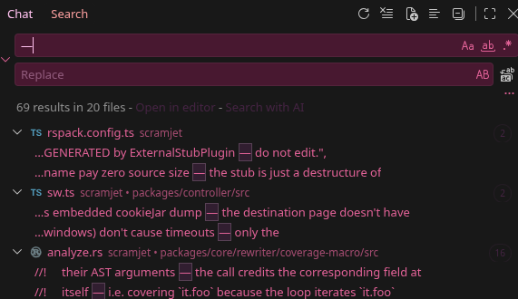

# End Internet Censorship

The internet's fourth temple.

*the greatest comeback of all time*

Open source for-profit initiative created by the original TompHTTP/UltraViolet maintainers and proxy developers.

🇮🇱 חופש מידע לכולם | Freedom of information for everyone

[fracit.al](http://fracit.al/) - [powerMouse](https://github.com/Fracital/powerMouse) - [Our repositories](https://github.com/orgs/Fracital/repositories)

## Hall of Shame

Scramjet: https://github.com/MercuryWorkshop/scramjet

Used by: Too many people.

Emdash counter: 69 (🤪)

EST: May 5, 2024

Alternative: https://github.com/Fracital/powerMouse

EST: Jun 9, 2020

> We believe in the ends, not the means, but we still think your software is shit if it's littered with emdashes and unfathomably stupid to write comments that no self-respecting developer would preserve.

## DO BETTER!!!

Our solution:

- a good AGENTS.md that doesn't vibeslop for you
- I CAN FIX YOUR ENTIRE CODEBASE IN A SINGLE DAY. HIRE ME ([reedswork@proton.me](mailto:reedswork@proton.me))
